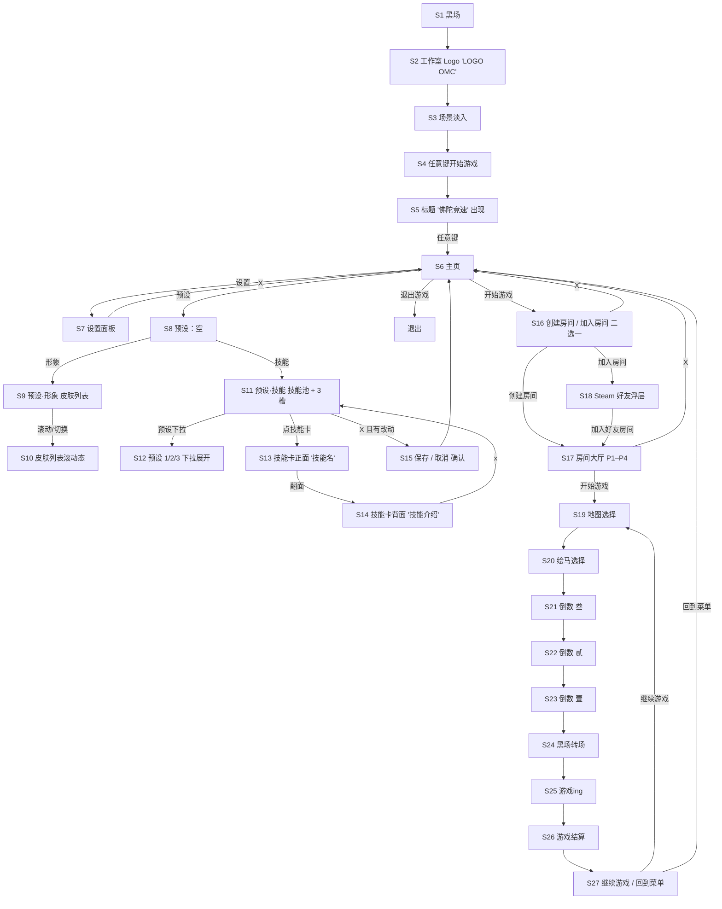

# 主菜单 Figma 原型整理

来源：Figma 文件 `U2sD7vbaXittK5Qm30iCVI`（用户早期原型），2026-11-06 只读整理。对照基线：分支 `MainMenu-UI`（cc7bc106）。
配套需求笔记：会话共享笔记 `main-menu-ui-requirements.md`（上一个会话写的现状与 P0/P1/P2 清单）。

> 原型是低保真线框，文字多为占位（如“皮肤1----”“佛陀竞速 logo”）。Figma 的原型连线（点击跳转）读取工具拿不到，下面的跳转关系是按画框排列顺序、文字和状态差异推断的，标了“推断”的地方需要用户确认。

## 文件结构

| Figma 页 | 内容 | 本文处理 |
|---|---|---|
| **Page 2** | 主菜单原型：一个组件 `Component 1`，28 个状态（1920×1080），外加一个预览用实例 | 主体，逐页整理 |
| Page 1 | 局内 HUD 草图：排名列表 + 奖杯、公告框“检测到执着值太高-即将接受天罚”、备注“3分钟后自动弹出”，以及参考截图 | 附录简述 |
| Page 3 | 局内 HUD 组件：排名卡（书法“贰” + player 列表）、技能卡“法相金身” + 搓招按键 ↑ W ↑（已作废：现为单键 Q/1 等）、小图标 5 态、黑色遮幅条 2 态 | 附录简述 |
| d'w'd | 参考图（情绪板），有一处标注“主殿 / 功能：换皮肤” | 不展开 |
| 主体建筑 | 建筑参考图 | 不展开 |

## 页面流转图

Page 2 的画框按三行排列：第一行从左到右是开场 → 主页 → 设置/预设；第二行从主页往左依次是开始游戏 → 房间 → 地图 → 绘马 → 倒数；第三行是黑场 → 游戏中 → 结算 → 继续/回菜单。

推断点：
- 地图选择 / 绘马选择在房间“开始游戏”之后、倒数之前（按画框位置推断）。
- 叁贰壹的顺序：画框从左到右是壹贰叁，但第二行整体从右往左走，所以按倒数“叁→贰→壹”理解。
- S27“继续游戏 / 回到菜单”放在结算下面，按结算后的选择理解；也可能是局内暂停菜单。
- “加入房间”画的是 Steam 好友浮层截图，理解为通过 Steam 好友/邀请加入，原型里没有房间列表。

## 通用风格特征

- **背景**：纯黑底，满屏白色细线描的密集佛教纹样/符文（像边缘检测后的浮雕拓片），左上角渐暗成纯黑，留出放文字的位置。
- **主体**：右侧是一组佛头 + 两只手印（灰粉色），外面绕着几圈手绘红色螺旋线（像赛道或迷宫）。佛头是全页唯一的视觉焦点，所有页面都保留它，只是被面板遮住一部分。
- **配色**：黑 / 白 / 红三色。红只用在螺旋线和少量强调（地图卡、绘马卡是红色块）。
- **文字**：白色、细、无框的纯文字按钮（主页、设置项）；房间大厅里改用细白描边的矩形框。字体是占位的系统黑体。
- **线条元素**：底部一条贯穿全屏的白色细横线，“任意键开始游戏”压在线中间；进入主页后线条延展成菜单栏的基线。
- **选中态**：底部菜单当前项上移一档（例如打开设置时“设置”抬高，打开预设时“预设”抬高）；预设页标题下有长下划线。
- **关闭**：所有覆盖层右上角一个大写 “X”。
- **书法**：倒数用超大书法数字“壹 / 贰 / 叁”，和局内 HUD 的书法 PNG 是同一套语言。
- **整体**：文字少、按钮少、场景当背景，和“简约禅意、场景当背景”的推荐方向一致；但原型的场景是暗黑抽象佛头，不是现在 Unity 里的黄昏神社。

## 逐页清单

Figma 节点 ID 写在括号里，方便回查。

### 开场（S1–S5）

| 页 | 节点 | 用途 | UI 元素 |
|---|---|---|---|
| S1 黑场 | `6:62` | 启动黑屏 | 无 |
| S2 工作室 Logo | `6:119`（`6:138` 同内容，推断为淡入/淡出两帧） | 显示工作室标志 | 居中大字“LOGO / OMC”；底部横线 + “任意键开始游戏” |
| S3 场景淡入 | `6:61` | 主菜单背景出现 | 只有背景（纹样 + 佛头 + 红螺旋） |
| S4 任意键 | `6:102` | 等待玩家按键 | 底部横线左右两段，中间“任意键开始游戏” |
| S5 标题 | `6:111` | 游戏名出现 | 左下大字“佛陀竞速”；任意键提示仍在 |

功能：启动序列（黑场 → 工作室 Logo → 场景 → 按任意键）、任意键进入主页、横线动画过渡到主页菜单栏。

### S6 主页 `6:259`（早期版本 `6:304` 底层）

- 用途：主入口。
- 布局：左上“佛陀竞速 logo”+ 下划线；右下一排纯文字按钮，压在全屏横线上。早期版本标题在左下、没有“预设”。
- 元素：
  - 按钮：**开始游戏**、**设置**、**预设**、**退出游戏**
  - 标题 Logo（占位文字）
  - 底部横线（从 S4 延展而来）
- 没画：单人游戏、版本号、网络状态。

### S7 设置 `41:825`

- 用途：游戏设置，覆盖在主页左半边。
- 布局：左侧竖向面板（约 744×857），右上 X；底部菜单“设置”抬高为选中态。
- 元素：
  - 标题“设置”
  - **音效 --**（推断为音量滑条）
  - **控制 --**，下面缩进两项 **搓招1 --**、**搓招2 --**（推断为技能搓招按键设置；搓招已取消，见 [玩法深化](../gameplay/README.md) §3，菜单里现为只读的「操作」页）
  - 关闭 X
- 没画：画面/画质、分辨率、语言。

### S8–S15 预设（配装）

预设是主页里的独立入口，用来在开局前配好形象和技能，并存成多套。

| 页 | 节点 | 内容 |
|---|---|---|
| S8 预设·空 | `53:1189` | 左上标题“预设”+ 长下划线；两个页签 **形象** / **技能**；右上 X |
| S9 形象 | `41:863` | 选中“形象”页签；左侧沿红螺旋排列 **皮肤1 / 皮肤2 / 皮肤3** 文字项；右侧佛头作为预览 |
| S10 形象·滚动 | `53:1213` | 皮肤项沿螺旋移动了位置，推断为滚动/轮盘切换动效 |
| S11 技能 | `41:903` | 选中“技能”页签；左侧大面板是**技能池**（7 张方卡，卡上“技能名”）；右下小面板是**当前配装 3 槽**；下面是**预设选择器“预设--1”** |
| S12 预设下拉 | `41:1045` | 预设选择器向上展开：**预设--1 / 预设--2 / 预设--3** |
| S13 技能卡正面 | `41:959` | 全屏压暗 + 居中大卡片，显示**技能名**；右上 x |
| S14 技能卡背面 | `41:1003` | 同一张卡翻到背面：**技能介绍** |
| S15 保存确认 | `41:1096` | 在技能页上弹出 **取消 / 保存**（推断为有未保存改动时关闭触发） |

功能清单：
- 页签切换：形象 / 技能
- 形象：皮肤列表（沿螺旋排布、可滚动），佛头实时预览
- 技能：技能池 → 拖/点进 3 个槽位；点卡片放大查看，卡片可翻面看介绍
- 多套预设：至少 3 套，可切换
- 保存 / 取消改动
- 关闭 X 回主页

### S16 开始游戏 → 房间方式 `6:304`

- 用途：选择联机方式。
- 布局：主页上叠一层，屏幕中间两行纯文字，右上 X。
- 元素：**创建房间**、**加入房间**、X。
- 没画：单人游戏、浏览房间列表、按 ID 加入。

### S17 房间大厅 `6:323`（倒数页 `6:453 / 6:431 / 6:399` 底层同布局）

- 用途：等待成员、开局。
- 布局：左上三个描边框按钮，下方一排 4 个玩家位，右上 X。
- 元素：
  - **房间名**（显示）
  - **皮肤选择**（按钮，在房间里换皮肤）
  - **开始游戏**（按钮，房主开局）
  - 玩家位 ×4：**P1名字 … P4名字** + 每人一个佛头手印头像
  - 关闭 X（离开房间）
- 没画：房间 ID / 邀请码、人数上限、公开/私密、准备按钮、房主标记、踢人。

### S18 加入房间 → Steam 好友浮层 `6:371`

- 用途：通过 Steam 好友加入。
- 内容：直接贴了 Steam 好友列表浮层截图和底部 Steam 工具栏。
- 功能：打开 Steam 好友/邀请，加入好友所在房间。

### S19 地图选择 `28:536`

- 布局：中间一个大面板（约 1512×827），左上大字“地图选择”。
- 元素：3 张横向地图卡（红色块，377×245）。
- 没画：地图名、预览、投票/倒计时、确认按钮。

### S20 绘马选择 `28:564`

- 布局：同地图选择面板。
- 元素：左上大字“绘马选择”；2 行 × 3 列共 6 张绘马卡（红色块）。
- 理解：局前选技能（绘马 = 技能）。和“预设·技能”的关系没画清楚，可能是用预设或局前再改。

### S21–S23 倒数 叁 / 贰 / 壹 `6:399 / 6:431 / 6:453`

- 布局：房间大厅布局之上，屏幕中间超大书法数字。
- 功能：开局倒计时 3 秒。

### S24–S27 局内与结算

| 页 | 节点 | 内容 |
|---|---|---|
| S24 黑场 | `6:474` | 转场黑屏 |
| S25 游戏中 | `6:498` | 占位文字“游戏ing.....” |
| S26 结算 | `6:505` | 占位文字“游戏结算.....” |
| S27 结算后选择 | `6:512` | 居中两项：**继续游戏**、**回到菜单** |

## 和代码现状对照

代码位置：`Assets/Scripts/UI/MenusUI/`（主菜单与选择场景），`Assets/Scripts/Match/UI/`（单人设置、结算、退出确认）。

### 原型和代码都有

| 功能 | 原型 | 代码 |
|---|---|---|
| 主页入口 + 退出 | S6 开始游戏 / 设置 / 预设 / 退出游戏 | `MainMenuUI` Home 面板；Quit 按钮；Esc 返回栈 |
| 设置入口 | S7 | `MainMenuUI.ShowSettings()` + `SettingsPanelUI` |
| 创建房间 | S16 → S17 | `CreateRoomUI`（房间名、人数上限、可见性、创建、返回） |
| 房间大厅 | S17 房间名、玩家位、开始游戏、X | `RoomUI`（房间名、房间 ID、状态、成员列表、准备、开始、离开）；原型环境还有 `MenuLobby`（6 席位） |
| 地图选择 | S19 | `PropertySelection` 场景的地图阶段（`PropertiesSelectorUI.mapSelectorRoot`），实际只有 RaceMap 一张 |
| 局前技能（绘马）选择 | S20 | `PropertySelection` 技能阶段（`SkillWallSelectionController`，绘马墙 3 槽）；原型环境 `MenuSkillLoadout` |
| 技能卡放大查看 | S13 | `SkillInspectController` / `SkillInspectPanelUI`（点绘马近看）、`MenuEmaInspector` |
| 皮肤选择 | S9、S17“皮肤选择” | `PropertySelection` 皮肤阶段；原型环境 `MenuSkinView`（佛像特写、拖拽旋转） |
| 开局倒计时 | S21–S23 书法数字 | 逻辑有：`RoomStateManager.IsRaceCountdownActive / RaceCountdownSecondsRemaining`；显示只在 legacy 调试文字里；书法数字 PNG 已有 |
| 转场黑场 | S1、S24 | `SceneFadeController` |
| 结算后选择 | S27 继续游戏 / 回到菜单 | 单人：`SoloResultsView`（再来一局 / 返回）；联机：`ResultDecisionManager` + legacy `ResultDecisionUI` |

### 原型有、代码没有

| 功能 | 原型位置 | 说明 |
|---|---|---|
| 启动序列：工作室 Logo、标题、任意键开始 | S1–S5 | 代码直接进主页，没有 splash 和“按任意键” |
| 标题 Logo“佛陀竞速” | S5、S6 | 没有标题 Logo |
| 底部横线菜单栏 + 选中项抬高 | S6、S7、S8 | 现在是竖排 uGUI 按钮 |
| **预设系统**：主页里的配装入口，形象 + 技能两页签，多套预设（1/2/3），保存/取消 | S8–S15 | 代码里技能和皮肤只在每局的 `PropertySelection` 里选，没有可保存的多套配装 |
| 技能卡翻面看介绍 | S14 | 有近看，没有正反面翻转 |
| 皮肤列表沿螺旋滚动 | S9–S10 | 现有皮肤选择是轮播 / 3D 佛像旋转 |
| 设置·音效 | S7 | 没有音频设置（也没有自有 AudioMixer） |
| 设置·控制 / 搓招按键 | S7 | 搓招已取消；「操作」页只读展示键位，不支持改键 |
| 通过 Steam 好友浮层加入 | S18 | 代码用房间列表 + 按 ID 加入；没有接 Steam 邀请/好友加入入口（需另查 `SteamLobbyManager` 是否处理 join 请求） |
| 房间里直接“皮肤选择” | S17 | 皮肤要等进 `PropertySelection` 才能选 |

### 代码有、原型没画到

| 功能 | 代码 | 备注 |
|---|---|---|
| **单人游戏入口 + 单人设置** | `SoloUIBootstrap` 注入“单人游戏”按钮；`SoloSetupPanel`（人数说明、难度 简单/普通/困难、开始单人赛、返回） | 原型“开始游戏”后只有联机两个选项，新 UI 需要给单人留入口 |
| 浏览房间列表 | `LobbyBrowserUI`（刷新、列表、空状态） | 原型用 Steam 好友代替 |
| 按 ID 加入 | `RoomJoinUI`（ID 输入、加入、错误提示） | 原型没画 |
| 创建房间参数：人数上限、可见性 | `CreateRoomUI` 下拉框 | 原型“创建房间”直接进大厅 |
| 房间 ID、准备按钮、房间状态文字 | `RoomUI` | 原型大厅没有准备流程 |
| 玩家人数 | 代码最多 6 人（`MenuLobby` 6 席位、单人 1+5 AI） | 原型只画了 4 个玩家位 |
| 设置·画面（画质档位、分辨率、窗口、VSync 等，应用/撤销/重置） | `SettingsPanelUI` | 原型设置里没有画面一节 |
| 联机可用性状态文字 | `SoloUIBootstrap` “正在初始化…”等 | 原型没有状态/错误提示 |
| 退出确认弹窗 | `QuitConfirmDialog`（局内，继续比赛 / 退出到主菜单） | 原型主页“退出游戏”没有确认；S27 也可能就是这个弹窗 |
| 选择阶段倒计时、玩家选择进度、准备 | `PropertiesSelectorUI`（countdownText、playersSelectionText、readyButton） | 原型地图/绘马页没有倒计时和确认 |
| 3D 场景交互（点本殿开始、点佛像换皮、拉铃绳、开殿门、沙盘俯视） | `MenuEnvironmentSetting` 原型脚本（`MenuBellRope`、`MenuRoomView`、`MenuSandTableFocus` 等） | Figma 原型是 2D 叠层，没有这些 3D 交互 |

## 给重做的提示

1. 原型的流程（开场 → 主页 → 开始游戏 → 房间 → 地图 → 绘马 → 倒数）和现有正式流程 `MainMenu → PropertySelection → RaceMap` 基本对得上；地图 / 绘马两页对应 `PropertySelection`。
2. 需要用户拍板的差异：
   - 单人游戏放哪（原型没有）。
   - “预设”是否要做成可保存的多套配装；如果做，局内的绘马选择是改成“选预设”还是保留每局重选。
   - 联机加入方式：保留房间列表 + ID，还是改成 Steam 好友邀请，或者都要。
   - 房间人数按 4 还是 6。
   - 设置里画面（已实现）+ 音效 + 控制三节的顺序和样式。
   - 背景：原型的暗黑抽象佛头，还是现有黄昏神社 3D 场景。
3. 原型里的风格元素（黑白红、细线、无框文字按钮、底部横线菜单栏、书法数字、右上 X）可以直接做成一套共用组件。

## 附录：局内 HUD 草图（Page 1 / Page 3）

不属于主菜单，记下来备查：
- 排名：1–6 player 列表 + 奖杯 + 领奖台；排名卡用书法数字（“贰”）+ 玩家名。
- 公告框：例句“检测到执着值太高-即将接受天罚”，备注“3分钟后自动弹出”（对应执着值系统 `ObsessionUI`）。
- 技能卡：书法技能名“法相金身” + 万字符图标 + 搓招按键提示 ↑ W ↑（已作废：现为单键 Q/1 等）。
- 小图标组件 5 个状态、黑色遮幅条 2 个状态（推断为过场电影遮幅）。
